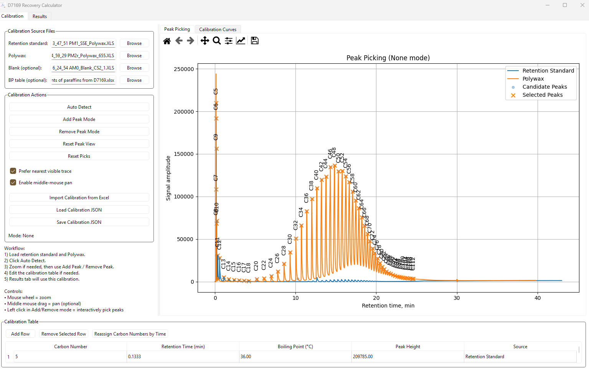
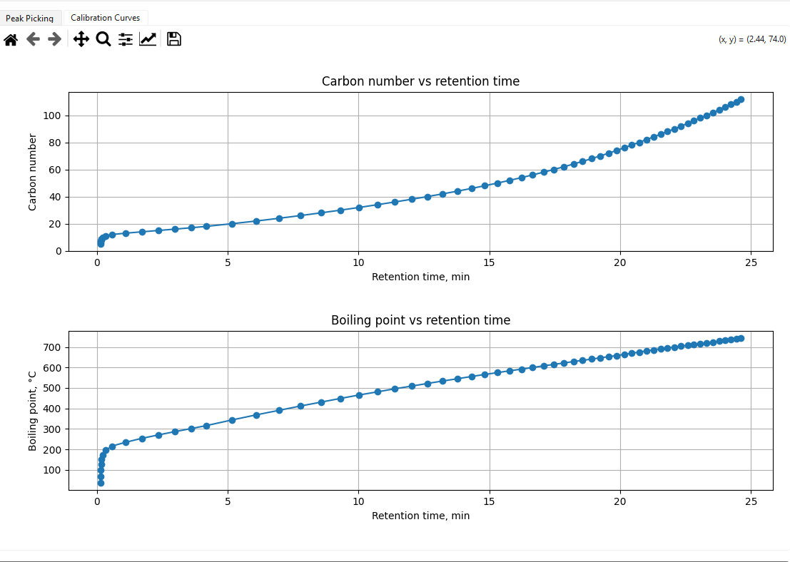
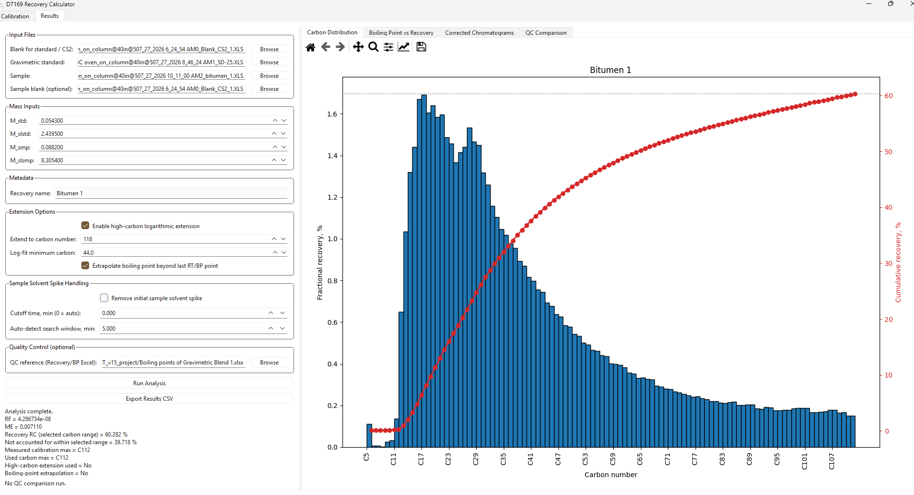
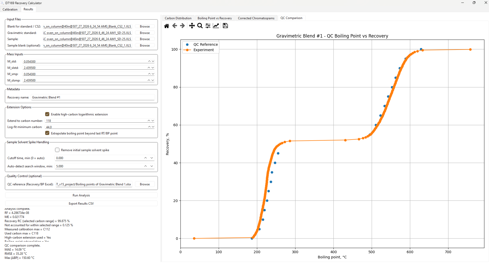

# Example: three anonymized bitumen samples

Run `python simdist_app.py` from the project folder using your virtual environment.

## Calibration editing (optional)

Skip this section when using the supplied `calibration.json`.

1. In **Calibration**, select the retention-standard and Polywax chromatograms, an appropriate blank if used, and `Boiling points of paraffins from D7169.xlsx` as the BP table. Rebuilding a calibration requires the relevant retention-standard trace; the bundled Polywax files alone are not a complete replacement.
2. Click **Auto Detect** to load the traces and select candidate peaks. Inspect the assignments against the known standards: a detected maximum does not establish its carbon number.
3. Correct the peak selection using the controls below. Turn off toolbar Pan/Zoom before adding or removing peaks.

| Action | Control |
| --- | --- |
| Add a peak | Select **Add Peak Mode**, then left-click near the peak maximum. |
| Remove a peak | Select **Remove Peak Mode**, then left-click near the selected peak. |
| Exit peak editing | Click the active mode button again; the mode should read **None**. |
| Zoom | Scroll up to zoom in and down to zoom out around the pointer, or use toolbar Zoom. |
| Pan | Hold and drag the middle mouse button with **Enable middle-mouse pan** checked, or use toolbar Pan. |
| Restore the full plot | Click **Reset Peak View**. |
| Clear all selected peaks | Click **Reset Picks**; this clears selections, not just the view. |

4. Review the table after edits: automatic sequential carbon assignments can shift when peaks are added or removed. Correct assignments against the known standard; **Reassign Carbon Numbers by Time** applies the preset sequence, not chemical identification. Check that carbon numbers, retention times, and boiling points increase consistently.
5. Click **Save Calibration JSON**. For the bitumen example below, load the supplied calibration again unless you intentionally want to test your new one.

### Peak-selection example

*The loaded standard traces span early elution and a series of later Polywax peaks. Markers and labels show the imported/selected calibration points. The screenshot illustrates the peak-editing interface; assignments must be checked against the known material, rather than accepted solely because Auto Detect found maxima.*

*The selected points establish the retention-time mappings. The saved calibration spans C5–C112 and 36–744 °C. Curvature matters: the conversion is not a single constant temperature increment per minute.*

## Inputs and settings

1. In **Calibration**, select **Load Calibration JSON** and load `calibration.json`: C5–C112, 36–744 °C.
2. In **Results**, select the files below from `results bitumen/`. Filenames are abbreviated by their distinguishing suffixes.

| Field | File suffix |
| --- | --- |
| Blank for standard / CS2 | `Blank_CS2_1.XLS` |
| Gravimetric standard | `SD-25.XLS` |
| Sample blank | `Blank_CS2_2.XLS` |
| Sample | `bitumen_1.XLS`, then `_2.XLS` and `_3.XLS` |

3. Enter the masses recorded in `results bitumen/masses.xlsx`:

| Sample | M_std | M_slstd | M_smp | M_slsmp |
| --- | ---: | ---: | ---: | ---: |
| Bitumen 1 | 0.0543 | 2.4395 | 0.0882 | 8.3054 |
| Bitumen 2 | 0.0543 | 2.4395 | 0.1202 | 6.6495 |
| Bitumen 3 | 0.0543 | 2.4395 | 0.1727 | 11.6715 |

Use one mass unit throughout; the sheet does not explicitly label units.

4. Set carbon maximum to **112**. Leave high-carbon extension, BP extrapolation, and initial sample solvent-spike removal **off**. Leave QC reference empty.
5. Set the recovery name and click **Run Analysis** for each sample.

## Expected output

| Sample | Recovery within C5–C112 |
| --- | ---: |
| Bitumen 1 | 62.264% |
| Bitumen 2 | 63.351% |
| Bitumen 3 | 59.898% |

The BP curve starts at 0% and 36 °C and ends at the corresponding recovery and 744 °C. These are computational reference outputs for the stated settings, not an independent analytical QC pass.

The example assumes Blank 1 applies to the standard and Blank 2 to the samples. Laboratory applicability of that mapping and the saved calibration must be established for scientific use. Polywax filenames carry 2025 dates and bitumen filenames carry 2026 dates; this example loads the saved calibration rather than rebuilding it from those traces.

## Illustrated Bitumen 1 run

The captured run uses the listed Bitumen 1 masses but **Blank 2 for both the standard and sample**. Its summary reports:

| Quantity | Captured result |
| --- | ---: |
| Recovery within selected range | 60.282% |
| Not accounted for within selected range | 39.718% |
| Calibration maximum / used maximum | C112 / C112 |
| Retention extension / BP extrapolation applied | No / No |

This differs from the baseline recipe above, which uses Blank 1 for the standard. Do not expect identical totals across different blank assignments.

The broad distribution has its largest displayed bin near C18 and a declining high-carbon tail. The cumulative curve sums those interval contributions. These describe n-paraffin-equivalent elution, not individual hydrocarbon identities.

Although the filename and checked controls suggest extension to C118, the **completed-analysis summary and plotted range show C112 with no extension applied**. The figure is therefore captioned as a C5–C112 result. To illustrate extension, rerun with the desired settings and capture the updated summary.

## Export

Click **Export Results CSV**, choosing a distinct name such as `bitumen_1.csv`. The app also writes `bitumen_1_bp_curve.csv`. Save figures through the Matplotlib toolbar. Keep the calibration, input masses, blank choices, and extension/spike settings with your exported results.

## Gravimetric-blend reference check

1. Select the SD-25 chromatogram as both standard and sample.
2. Set `M_std = M_smp = 0.0543` and `M_slstd = M_slsmp = 2.4395`.
3. Use the same blank for both inputs. Disable sample solvent-spike removal, high-carbon extension, and BP extrapolation; keep carbon maximum at 112.
4. Load `Boiling points of Gravimetric Blend 1.xlsx` in the QC reference field.
5. Click **Run Analysis** and inspect **QC Comparison**.

For the nominal 50/50 blend, compare integrated contributions from the two fractions, rather than expecting equal individual histogram bars. Compare the BP–recovery curve against the supplied reference. This checks processing and distribution shape; using the same chromatogram twice does not independently validate the response factor or total recovery. Selected-range recovery can exclude signal. The app does not automatically apply the reference's `Deviation` tolerances; review them separately before claiming a QC pass.

### Captured gravimetric-blend comparison

This is the **SD-25 reference-check run**, not an unknown bitumen analysis. The same standard chromatogram, blank, and masses are used on both sides. The completed run reports C118 with extension and BP extrapolation applied, whereas the baseline check above uses C112 without extension.

| Quantity | Captured result |
| --- | ---: |
| Selected-range recovery | 99.875% |
| Mean absolute BP error | 14.09 °C |
| BP RMSE | 35.28 °C |
| Maximum absolute BP error | 150.60 °C |

The orange curve and blue reference points show two main rises separated by a plateau near 50% recovery. This provides a useful shape comparison, but the reported errors show discrepancies requiring review. The screenshot does not establish a tolerance pass or independent recovery validation. Its endpoint temperatures include extrapolated values; the app does not automatically evaluate the supplied tolerance column.

The Bitumen 1 screenshot has a QC file selected, but its summary says no QC comparison was run. Compare the gravimetric reference with the standard run, not with an unknown bitumen distribution.
