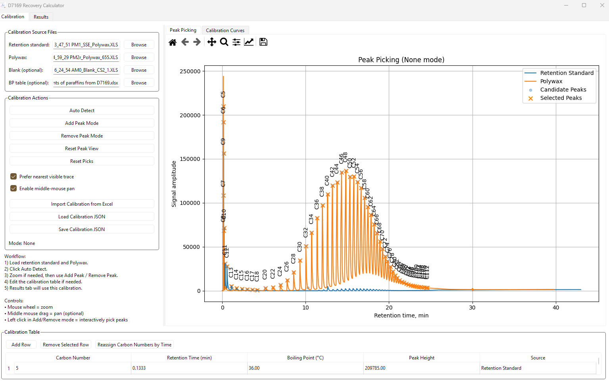
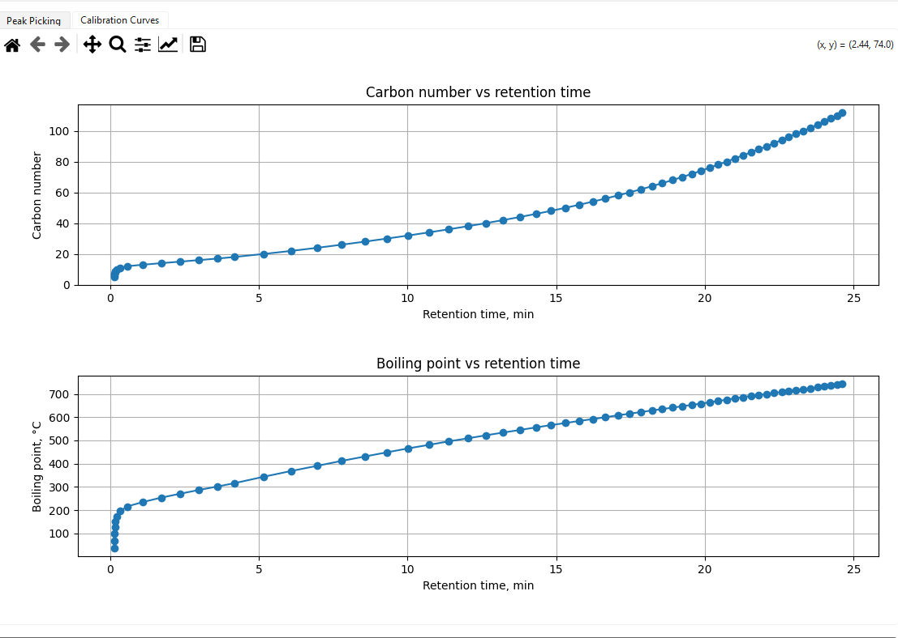
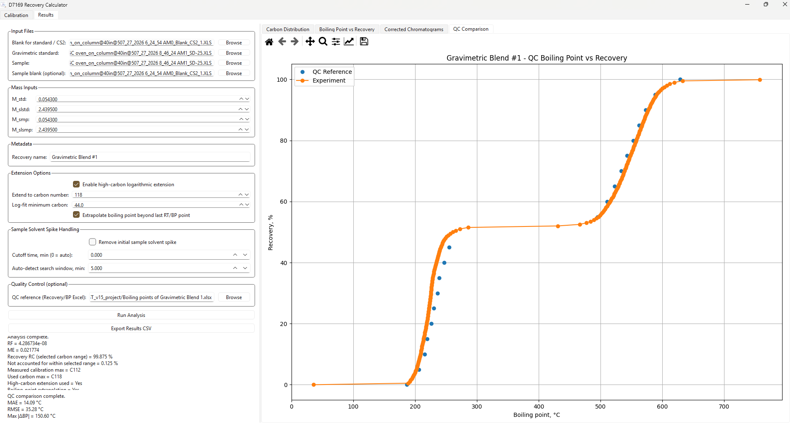
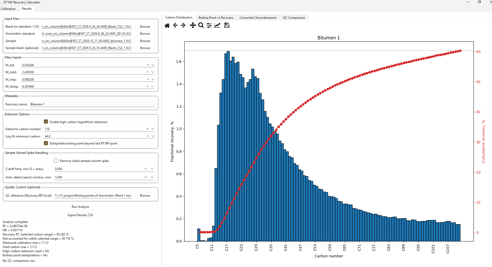

# SimDist: short CMG walkthrough

## GitHub repository description

Python/PySide6 tool for heavy-hydrocarbon GC analysis: interactive calibration, blank correction, gravimetric scaling, and carbon-equivalent/BP–recovery curves.

## Opening: the problem

“I developed SimDist to turn raw high-temperature GC measurements into interpretable heavy-hydrocarbon distributions through a repeatable desktop workflow.”

## 1. Review the calibration peaks

“First I inspect the standard and Polywax traces, review detected peaks, and correct their assignments interactively. Detection finds candidate maxima; identification comes from the known standards.”

## 2. Map measurement to physical coordinates

“The reviewed points connect retention time to n-paraffin-equivalent carbon number and boiling point. I keep the calibrated range explicit and distinguish it from optional extrapolation.”

## 3. Inspect a reference comparison

“I process a gravimetric blend and compare its BP curve with supplied reference values. The two-rise structure is visible, but the reported errors mean I would not call this a formal QC pass. Using the same run as both standard and sample checks shape and processing, rather than independently verifying response scaling.”

## 4. Apply the workflow to Bitumen 1

“The example shows a broad distribution with a high-carbon tail. The captured analysis reports 60.282% recovery within C5–C112. The histogram and cumulative curve share one integral, so the two views have the same mass basis.”

## Engineering contribution

“The main software work was connecting calibration, interactive review, blank correction, gravimetric scaling, consistent integration, visualization, and export. I also corrected partial-bin integration and synchronized calibration imports with the peak plot. This demonstrates how I translate an experimental workflow into scientific software while keeping assumptions visible.”

These screenshots demonstrate analytical data processing. The application does not perform EOS characterization, K-value estimation, or flash calculations. It complements those projects rather than replacing them.
