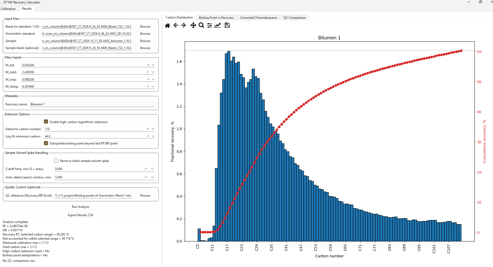

# SimDist — v1.0.0

A Python/PySide6 desktop app for processing high-temperature gas chromatography data from heavy-oil and bitumen samples. It combines calibration, blank correction, mass inputs, plotting, and CSV export. Developed by Ilia Kuznetcov.

## Example: Bitumen 1

Standard and Polywax peaks link retention time to equivalent carbon number and boiling point. The app then uses a gravimetric standard and the recorded sample masses to calculate recovery.



*Bitumen 1: 60.282% recovery within C5–C112. Blue bars show recovery per carbon interval; the red curve shows cumulative recovery.*

See [EXAMPLE.md](EXAMPLE.md) for settings and instructions, and [PRESENTATION.md](PRESENTATION.md) for an illustrated walkthrough.

## Features

- Interactive retention-standard and Polywax calibration; JSON import/export.
- Blank correction and gravimetric-standard response scaling.
- Carbon distributions, cumulative recovery, BP curves, and optional QC comparison.
- Optional high-carbon extension, BP extrapolation, and sample solvent-spike removal.
- CSV exports and Matplotlib plot controls.

## Install and run

Use your existing virtual environment, or create one:

```powershell
python -m venv .venv
.\.venv\Scripts\Activate.ps1
python -m pip install -r requirements.txt
python simdist_app.py
```

Dependencies are listed without version pins; use your tested environment for the release build.

## Example

See [EXAMPLE.md](EXAMPLE.md) for the supplied three-bitumen dataset, masses, settings, and expected results. Load `calibration.json` before analysis. For calibration editing, use the supplied paraffin BP spreadsheet; startup defaults are not the example's calibration.

Optional peak editing, plot navigation, and a gravimetric-blend reference check are also described in [EXAMPLE.md](EXAMPLE.md).

## Calculation and interpretation

Signals are aligned to the standard time grid, clipped at zero, blank-subtracted, and clipped again.

### Response factor and recovery

The gravimetric standard sets the response factor:

$
RF=\frac{M_{\mathrm{std}}}{M_{\mathrm{std}}+M_{\mathrm{sol,std}}}\frac{1}{A_{\mathrm{std}}}
$

Recovery within the selected carbon range is:

$
R_{\mathrm{range}}=100\,RF\,\frac{M_{\mathrm{smp}}+M_{\mathrm{sol,smp}}}{M_{\mathrm{smp}}}\,A_{\mathrm{smp,range}}
$

| Symbol | Meaning |
| --- | --- |
| M_std, M_sol,std | Standard material and solvent masses |
| M_smp, M_sol,smp | Sample material and solvent masses |
| A_std | Blank-corrected standard area over its acquisition interval |
| A_smp,range | Blank-corrected sample area between the selected carbon boundaries |

Use the same mass unit throughout. Response scaling assumes comparable injection conditions and detector response for the standard and sample.

### Calibration mapping and integration

1. Assign known carbon numbers to selected standard and Polywax peaks, then obtain their boiling points from the paraffin lookup table.
2. Linearly interpolate retention time at each integer carbon boundary.
3. Integrate the corrected sample signal between those boundaries. A piecewise-linear signal integral includes partial acquisition intervals at bin edges.
4. For the BP curve, find the retention time at each cumulative-recovery level using the same integral, then convert time to boiling point with PCHIP interpolation of the calibration points.

Cumulative recovery starts at zero at the lower selected carbon boundary and ends at the selected-range total. Results remain on a sample-mass basis; they are not normalized to 100%. BP mapping uses shape-preserving interpolation of the calibration points. Extension beyond the measured range is an estimate, marked on the plots.

The quantity `100 − selected-range recovery` is material not accounted for within that range, not an independently measured non-eluting residue. Carbon numbers are n-paraffin equivalents, not molecular identification. Blank selection, calibration applicability, baseline treatment, and solvent exclusion affect interpretation. The optional QC comparison does not automatically enforce the reference's `Deviation` tolerances.

Developed for research using an ASTM D7169-related workflow. Numerical integration and endpoint checks passed on the supplied examples, and the corrected app was checked locally on Windows. Full analytical validation remains separate from these software checks.

